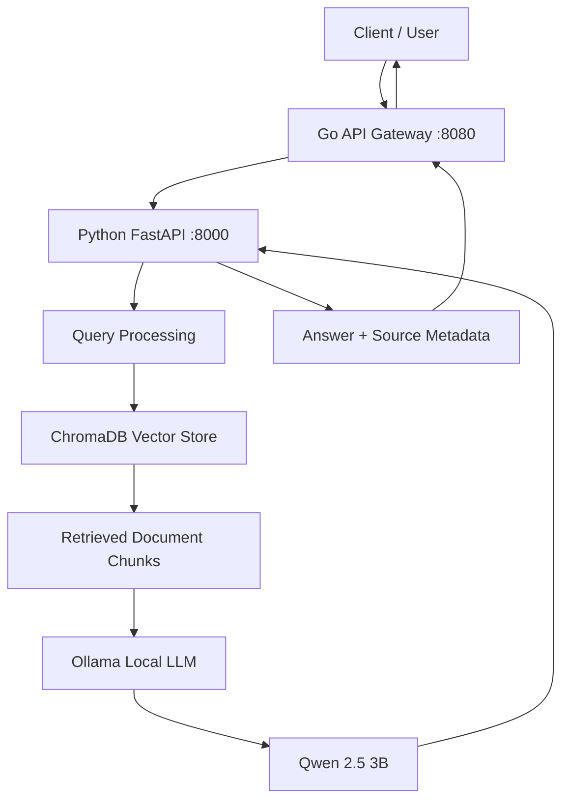

# SatelliteOps AI

**An AI-powered satellite operations assistant built with Go, Python, Retrieval-Augmented Generation (RAG), ChromaDB, and a locally hosted Large Language Model.**

SatelliteOps AI is a document-grounded AI assistant designed to help satellite operations teams retrieve operational knowledge and investigate satellite-related issues through natural-language questions.

The system combines a Go API gateway with a Python-based RAG pipeline to retrieve relevant information from a satellite operations knowledge base and generate contextual answers using a locally hosted LLM.

Unlike a conventional chatbot, SatelliteOps AI uses document retrieval to provide answers supported by source references. When the available documents do not contain the requested information, the system is designed to acknowledge the knowledge gap rather than fabricate an answer.

---

## Table of Contents

1. [Project Overview](#project-overview)
2. [Key Features](#key-features)
3. [System Architecture](#system-architecture)
4. [Technology Stack](#technology-stack)
5. [Project Structure](#project-structure)
6. [Prerequisites](#prerequisites)
7. [Installation and Setup](#installation-and-setup)
8. [Document Ingestion and Vector Indexing](#document-ingestion-and-vector-indexing)
9. [Running the Application](#running-the-application)
10. [API Documentation](#api-documentation)
11. [Example Usage](#example-usage)
12. [Testing and Validation](#testing-and-validation)
13. [Engineering Decisions](#engineering-decisions)
14. [Limitations](#limitations)
15. [Future Improvements](#future-improvements)

---

## Project Overview

Satellite operations involve monitoring satellite health, investigating anomalies, troubleshooting communication issues, and following established operational procedures.

Relevant operational information is often distributed across multiple technical documents. Finding the right information quickly can be challenging, especially when operators need to investigate an issue.

SatelliteOps AI addresses this problem through a Retrieval-Augmented Generation (RAG) architecture.

The application allows users to submit natural-language questions and receive answers generated from relevant documents in the knowledge base.

The system follows this workflow:

1. A user submits a question through the Go API gateway.
2. The Go gateway validates the request and forwards it to the Python service.
3. The Python service performs semantic retrieval using ChromaDB.
4. Relevant document chunks are provided as context to the local LLM.
5. The LLM generates an answer based on the retrieved information.
6. The Python service returns the answer with source references.
7. The Go gateway forwards the response to the client.

The project demonstrates the integration of backend engineering, AI application development, semantic search, and local LLM inference.

## Key Features

- **Retrieval-Augmented Generation (RAG):** Generates answers using information retrieved from a document knowledge base.
- **Semantic Search:** Uses ChromaDB to retrieve relevant document chunks based on query meaning.
- **Source Attribution:** Returns document references and metadata alongside generated answers.
- **Grounded Answer Generation:** Uses retrieved context to guide LLM responses.
- **Knowledge Gap Recognition:** Handles questions when the available documents do not contain the requested information.
- **Multi-Service Architecture:** Separates API gateway responsibilities from AI processing.
- **Local LLM Inference:** Uses Ollama and Qwen 2.5 3B without requiring a paid LLM API for the configured workflow.
- **API Validation:** Handles malformed requests, empty messages, and unexpected JSON fields.
- **Reliability Handling:** Includes upstream timeout handling, response size limits, and service availability handling.
- **Automated Testing:** Includes Python and Go tests for important application behavior.

## System Architecture

SatelliteOps AI uses a multi-service architecture.



### Component Responsibilities

| Component | Responsibility |
|---|---|
| Go API Gateway | Request validation, HTTP handling, timeout management, and response forwarding |
| Python FastAPI | AI service, retrieval orchestration, and answer generation |
| ChromaDB | Persistent vector storage and semantic retrieval |
| Ollama | Local LLM inference |
| Qwen 2.5 3B | Context-based answer generation |
| Document Knowledge Base | Stores satellite operations reference documents |

### Request Flow

1. The client sends a question to `POST /analyze`.
2. The Go gateway validates the incoming request.
3. The gateway converts the incoming `message` field into the `query` field expected by Python.
4. The Python service searches ChromaDB for relevant document chunks.
5. Retrieved chunks are passed to the LLM as supporting context.
6. The LLM generates an answer using the retrieved context.
7. The Python service returns the answer and source metadata.
8. The Go gateway forwards the response to the client.

## Technology Stack

| Technology | Purpose |
|---|---|
| Go | HTTP gateway and backend request handling |
| Python | AI processing and RAG implementation |
| FastAPI | Python REST API |
| ChromaDB | Vector database and semantic retrieval |
| Ollama | Local LLM runtime |
| Qwen 2.5 3B | Language model for answer generation |
| OpenAI Python SDK | Client interface for the OpenAI-compatible local Ollama endpoint |
| pytest | Python automated testing |
| Go testing package | Go unit and API behavior testing |

## Project Structure

```text
SatelliteOps-AI/
│
├── go-service/
│   ├── main.go
│   ├── main_test.go
│   └── go.mod
│
├── python-service/
│   ├── app/
│   │   ├── __init__.py
│   │   ├── main.py
│   │   ├── ingestion.py
│   │   ├── vector_store.py
│   │   └── llm.py
│   │
│   ├── tests/
│   │   ├── test_answer_api.py
│   │   ├── test_ingestion.py
│   │   └── test_retrieval_api.py
│   │
│   ├── requirements.txt
│   └── requirements-dev.txt
│
├── data/
│   ├── documents/
│   │   ├── satellite_health.md
│   │   ├── incident_response.md
│   │   └── communication_systems.txt
│   │
│   └── processed/
│       └── chunks.jsonl
│
├── chroma_db/
│
├── .env.example
├── .gitignore
└── README.md
```

**Note:** `.venv/`, generated processing files, and the persistent ChromaDB directory are local development artifacts and may be excluded from Git.

## Prerequisites

Install the following software:

- Git
- Go
- Python 3.12
- Ollama

The project uses the following local model:

```text
qwen2.5:3b
```

Check your installations:

```powershell
go version
python --version
git --version
ollama --version
```

Download the model if it is not already installed:

```powershell
ollama pull qwen2.5:3b
```

Ensure Ollama is running before starting answer generation.

## Installation and Setup

The following instructions use Windows PowerShell.

### 1. Clone the Repository

```powershell
git clone <YOUR_GITHUB_REPOSITORY_URL>

cd SatelliteOps-AI
```

### 2. Set Up the Python Environment

Navigate to the Python service:

```powershell
cd python-service
```

Create a virtual environment:

```powershell
python -m venv .venv
```

Activate it:

```powershell
.\.venv\Scripts\Activate.ps1
```

Upgrade pip:

```powershell
python -m pip install --upgrade pip
```

Install project dependencies:

```powershell
pip install -r requirements.txt
```

Install development dependencies:

```powershell
pip install -r requirements-dev.txt
```

Return to the project root:

```powershell
cd ..
```

### 3. Configure Environment Variables

Review `.env.example` and configure the local environment according to the application settings.

The current Ollama configuration uses a local OpenAI-compatible endpoint:

```text
http://localhost:11434/v1
```

The configured model is:

```text
qwen2.5:3b
```

The local Ollama workflow does not require a paid OpenAI API key.

Do not commit credentials, API keys, or other sensitive information.

## Document Ingestion and Vector Indexing

SatelliteOps AI uses a document knowledge base containing satellite operations information.

The current sample documents include:

- `satellite_health.md`
- `incident_response.md`
- `communication_systems.txt`

The ingestion process converts source documents into smaller text chunks for semantic retrieval.

The processed chunks are stored in:

```text
data/processed/chunks.jsonl
```

### Populate the ChromaDB Vector Store

From the project root, activate the Python environment if it is not already active:

```powershell
.\python-service\.venv\Scripts\Activate.ps1
```

Run the vector indexing script:

```powershell
python .\python-service\app\vector_store.py
```

The script uses the processed chunks to populate the persistent ChromaDB database.

The configured collection is:

```text
satellite_operations
```

The persistent database directory is:

```text
chroma_db/
```

**Important:** The processed `chunks.jsonl` file must exist before running the indexing script. If starting with new source documents, execute the project's document ingestion workflow first.

## Running the Application

SatelliteOps AI requires three running components:

1. Ollama
2. Python FastAPI service
3. Go API gateway

Use separate PowerShell terminals to run the services simultaneously.

### Terminal 1: Ollama

Ensure Ollama is running and the model is available:

```powershell
ollama list
```

Verify that `qwen2.5:3b` appears in the model list.

### Terminal 2: Python FastAPI

Navigate to the Python service:

```powershell
cd python-service
```

Activate the virtual environment:

```powershell
.\.venv\Scripts\Activate.ps1
```

Start the API:

```powershell
python -m uvicorn app.main:app --reload --port 8000
```

The Python API will be available at:

```text
http://localhost:8000
```

Interactive API documentation:

```text
http://localhost:8000/docs
```

### Terminal 3: Go API Gateway

From the repository root:

```powershell
cd go-service
```

Start the gateway:

```powershell
go run .
```

The Go gateway will be available at:

```text
http://localhost:8080
```

## API Documentation

### Go API Gateway

The Go gateway exposes the following endpoints.

#### GET `/health`

Checks whether the Go gateway is running.

Example response:

```json
{
  "status": "ok",
  "service": "go-gateway"
}
```

#### POST `/analyze`

Accepts a natural-language question and forwards it to the Python AI service.

Request:

```json
{
  "message": "What should operators do when a satellite enters safe mode?"
}
```

The gateway converts `message` into the `query` field expected by Python.

A successful response follows this structure:

```json
{
  "query": "What should operators do when a satellite enters safe mode?",
  "answer": "Generated answer based on retrieved documents. [S1]",
  "sources": [
    {
      "id": "S1",
      "source": "satellite_health.md",
      "chunk_index": 0
    }
  ],
  "source_count": 1
}
```

The example values are illustrative.

### Python AI Service

#### GET `/health`

Checks Python service availability.

Example response:

```json
{
  "status": "ok",
  "service": "python-ai"
}
```

#### POST `/retrieve`

Retrieves relevant document chunks without generating an LLM response.

Request:

```json
{
  "query": "satellite communication failure",
  "top_k": 3
}
```

Response structure:

```json
{
  "query": "satellite communication failure",
  "results": [
    {
      "text": "Example retrieved document text.",
      "source": "incident_response.md",
      "chunk_index": 0,
      "distance": 0.25
    }
  ],
  "result_count": 1
}
```

#### POST `/answer`

Retrieves supporting documents and generates a contextual answer using the configured local LLM.

Request:

```json
{
  "query": "What should operators do when a satellite enters safe mode?",
  "top_k": 3
}
```

Response fields:

| Field | Description |
|---|---|
| `query` | Original question |
| `answer` | Generated answer |
| `sources` | Supporting document references |
| `source_count` | Number of returned source references |

For complete interactive request and response schemas, visit:

`http://localhost:8000/docs`

## Example Usage

### 1. Check Service Health

Check the Go gateway:

```powershell
Invoke-RestMethod http://localhost:8080/health
```

Check the Python service:

```powershell
Invoke-RestMethod http://localhost:8000/health
```

### 2. Ask a Question Through the Go Gateway

```powershell
$body = @{
    message = "What should operators do when a satellite enters safe mode?"
} | ConvertTo-Json

$response = Invoke-RestMethod `
    -Uri "http://localhost:8080/analyze" `
    -Method POST `
    -ContentType "application/json" `
    -Body $body

$response | ConvertTo-Json -Depth 10
```

### 3. Example: Grounded Answer Generation

Question:

```text
What should operators do when a satellite enters safe mode?
```

The system retrieves relevant information from the document knowledge base and generates an answer with references.

Example answer:

```text
Operators should follow these steps when a satellite enters safe mode:

1. Identify the affected subsystem.
2. Validate the observation.
3. Check for related issues.
4. Record findings and unresolved questions.
5. Escalate according to the approved mission procedure.
```

The generated response includes references such as `[S1]` and `[S2]`, along with source metadata.

### 4. Example: Handling Unavailable Information

Question:

```text
What is the exact launch date and orbital altitude of this satellite?
```

Observed system behavior:

```text
The provided excerpts do not contain any information
about the launch date or orbital altitude of the satellite.

Therefore, I cannot answer this question based on
the given information.
```

The system identifies that the requested information is missing from the retrieved documents instead of generating unsupported values.

## Testing and Validation

SatelliteOps AI includes automated tests for both the Python AI service and the Go gateway.

### Python Tests

Run from the `python-service` directory with the virtual environment activated:

```powershell
python -m pytest tests -v
```

Verified result:

```text
12 passed
```

The Python tests cover:

- Answer generation API behavior.
- Request validation.
- Retrieval failure handling.
- Generation failure handling.
- Document chunking.
- Ingestion behavior.
- Retrieval API behavior.
- Health endpoint behavior.
- Response structure and source metadata.

### Go Tests

Run from the `go-service` directory:

```powershell
go test ./... -v
```

Additional checks:

```powershell
go vet ./...
go build .
```

Verified results:

- All 5 Go test functions passed, including 4 invalid-request subtests.
- `go vet` completed successfully.
- `go build` completed successfully.

### End-to-End Validation

The complete application was tested using the following pipeline:

```text
Client
  |
  v
Go Gateway
  |
  v
Python FastAPI
  |
  v
ChromaDB Retrieval
  |
  v
Ollama / Qwen 2.5 3B
  |
  v
Generated Answer + Sources
```

Two end-to-end scenarios were successfully verified:

| Scenario | Expected Behavior | Result |
|---|---|---|
| Grounded question | Generate a contextual answer with source references | Passed |
| Unanswerable question | Acknowledge missing information without inventing facts | Passed |

These results demonstrate that the core application pipeline works across both services and the local LLM.

## Engineering Decisions

### 1. Separating the Gateway and AI Service

Go and Python have different responsibilities in the system.

Go handles HTTP gateway responsibilities, including request validation, timeout management, and upstream communication.

Python handles AI-specific operations, including document retrieval, RAG orchestration, and LLM integration.

This separation keeps the backend gateway independent from the AI implementation.

### 2. Using a Local LLM

The project initially explored a hosted LLM API but encountered API quota limitations.

Ollama was selected to support local inference without requiring paid API usage for the configured workflow.

The selected model is Qwen 2.5 3B, which provides a practical balance between model capability and local hardware requirements.

### 3. Using ChromaDB

ChromaDB provides persistent vector storage and semantic retrieval.

Instead of passing the entire document collection to the LLM, the system retrieves relevant chunks and uses them as context.

This reduces unnecessary context and helps ground generated responses in the available knowledge base.

### 4. Returning Source Metadata

The Python service returns source references alongside generated answers.

This allows clients to identify which documents contributed to the generated response and provides a foundation for future answer verification and traceability.

## Limitations

- Answer quality depends on the quality and completeness of the source documents.
- Retrieval relevance depends on document chunking and semantic search performance.
- Local LLM inference performance depends on available hardware resources.
- A generated citation does not independently guarantee that every statement is fully supported by its referenced document.
- The current implementation focuses on document retrieval and grounded answer generation rather than autonomous satellite operations.
- The project is a portfolio prototype and is not a certified satellite control or mission-critical operational system.

## Future Improvements

Potential improvements include:

- Developing a web-based frontend for interactive question answering.
- Adding document upload, ingestion, and re-indexing controls.
- Implementing retrieval quality evaluation and answer-grounding metrics.
- Adding structured logging, observability, and performance monitoring.
- Introducing authentication and rate limiting before public deployment.
- Adding conversation history and contextual follow-up questions.
- Exploring agentic workflows with clearly defined tools and safety boundaries.
- Deploying the application using Docker and a production-ready service architecture.

## License

No license has been selected yet.

Choose and add an appropriate open-source license before distributing the project or accepting external contributions.

---

**SatelliteOps AI**  
*An AI-powered satellite operations assistant demonstrating backend engineering, Retrieval-Augmented Generation, semantic search, and local LLM integration.*