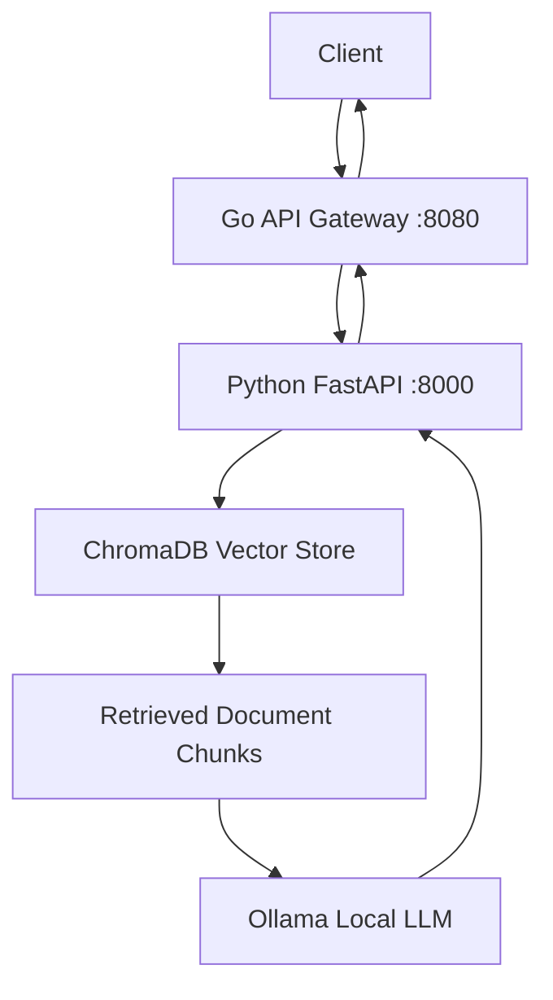

# SatelliteOps AI

**An AI-powered satellite operations assistant built with Go, Python, Retrieval-Augmented Generation (RAG), and a local LLM.**

SatelliteOps AI answers satellite operations questions by retrieving relevant information from a document knowledge base and generating responses grounded in that context.

The project demonstrates a multi-service AI architecture: a Go API gateway handles client requests, while a Python service manages semantic retrieval and LLM-powered answer generation.

## Architecture



### Request flow

1. A client submits a question to the Go gateway.
2. The gateway validates the request and forwards the question to the Python API.
3. The Python service retrieves relevant document chunks from ChromaDB.
4. The retrieved context is passed to a local language model through Ollama.
5. The Python service returns an answer and source metadata.
6. The Go gateway forwards the response to the client.

## Technology Stack

- **Go:** HTTP gateway, request validation, timeout handling, and upstream response forwarding.
- **Python:** AI service and document retrieval pipeline.
- **FastAPI:** Python REST API and interactive API documentation.
- **ChromaDB:** Persistent vector storage and semantic retrieval.
- **Ollama:** Local LLM inference.
- **Qwen 2.5 3B:** Local language model used for answer generation.
- **pytest:** Python automated testing.
- **Go testing package:** Gateway and API contract tests.

## Features

- Semantic search over satellite operations documents.
- Context-grounded LLM answers with source references.
- Separate Go gateway and Python AI service.
- Request validation and structured error responses.
- Request and response size limits in the Go gateway.
- Upstream timeout and unavailable-service handling.
- Automated tests for important API behavior.
- Local model inference without requiring a paid LLM API for the configured workflow.

## Project Structure

```text
SatelliteOps-AI/
├── go-service/
│   ├── main.go
│   ├── main_test.go
│   └── go.mod
├── python-service/
│   ├── app/
│   │   ├── __init__.py
│   │   ├── main.py
│   │   ├── ingestion.py
│   │   ├── vector_store.py
│   │   └── llm.py
│   ├── tests/
│   └── requirements.txt
├── data/
│   ├── documents/
│   └── processed/
├── chroma_db/
├── .env.example
├── .gitignore
└── README.md
```

Generated data, the local virtual environment, and the persistent vector database may be excluded from Git according to the repository's `.gitignore`.

## Prerequisites

Install the following before running the project:

- Git
- Go
- Python 3.11 or a compatible version supported by the installed dependencies
- Ollama
- The configured Ollama model: `qwen2.5:3b`

Check your installations:

```powershell
go version
python --version
git --version
ollama --version
```

Pull the model if it is not already installed:

```powershell
ollama pull qwen2.5:3b
```

Ensure Ollama is running and the model is available before testing answer generation.

## Local Setup

Run the commands from the repository root in PowerShell.

### 1. Set up the Python service

```powershell
cd python-service

python -m venv .venv
.\.venv\Scripts\Activate.ps1

python -m pip install --upgrade pip
pip install -r requirements.txt
```

If PowerShell blocks virtual-environment activation, you can invoke the environment's Python directly:

```powershell
.\.venv\Scripts\python.exe -m pip install -r requirements.txt
```

### 2. Configure environment variables

Review `.env.example` and create or update your local `.env` file if the application requires environment variables.

Do not commit API keys, credentials, or other secrets. The current local Ollama configuration uses an OpenAI-compatible local endpoint and does not require a paid OpenAI API key.

### 3. Prepare the document knowledge base

Ensure the source documents exist under `data/documents/` and follow the project's ingestion workflow to create the processed chunks and populate the vector store.

Run the ingestion command defined by your current implementation before querying an empty or newly created database.

### 4. Start the Python API

From `python-service/`:

```powershell
python -m uvicorn app.main:app --reload --port 8000
```

The API should be available at:

- Health: `http://localhost:8000/health`
- Interactive API documentation: `http://localhost:8000/docs`

### 5. Start the Go gateway

Open a second PowerShell terminal:

```powershell
cd D:\.DOCS\Portfolio\SatelliteOps-AI\go-service

go run .
```

The gateway should be available at `http://localhost:8080`.

## API Reference

### Go Gateway

#### `GET /health`

Checks gateway availability.

Example response:

```json
{
  "status": "ok",
  "service": "go-gateway"
}
```

#### `POST /analyze`

Accepts a question and forwards it to the Python `/answer` endpoint.

Request:

```json
{
  "message": "How should a satellite communication failure be handled?"
}
```

The gateway converts `message` into the `query` field expected by the Python service.

A successful response contains the Python answer structure:

```json
{
  "query": "How should a satellite communication failure be handled?",
  "answer": "Example answer based on retrieved context.",
  "sources": [
    {
      "id": "example-source-id",
      "source": "incident_response.md",
      "chunk_index": 0
    }
  ],
  "source_count": 1
}
```

The values above are illustrative, not actual model output.

### Python AI Service

#### `GET /health`

Checks Python service availability.

Example response:

```json
{
  "status": "ok",
  "service": "python-ai"
}
```

#### `POST /retrieve`

Retrieves relevant document chunks without generating an LLM answer.

Request:

```json
{
  "query": "How should a satellite communication failure be handled?",
  "top_k": 3
}
```

Response structure:

```json
{
  "query": "How should a satellite communication failure be handled?",
  "results": [
    {
      "text": "Example retrieved document text.",
      "source": "incident_response.md",
      "chunk_index": 0,
      "distance": 0.25
    }
  ],
  "result_count": 1
}
```

#### `POST /answer`

Retrieves supporting chunks and generates an answer using the configured local LLM.

Request:

```json
{
  "query": "How should a satellite communication failure be handled?",
  "top_k": 3
}
```

Response fields:

| Field | Description |
|---|---|
| `query` | Original question |
| `answer` | Generated answer |
| `sources` | Supporting source references |
| `source_count` | Number of returned source references |

For interactive request and response schemas, open `http://localhost:8000/docs` while the Python service is running.

## Example Requests

Run these commands in PowerShell while both services are running.

### Check service health

```powershell
Invoke-RestMethod http://localhost:8080/health
Invoke-RestMethod http://localhost:8000/health
```

### Ask a question through the Go gateway

```powershell
$body = @{
    message = "How should a satellite communication failure be handled?"
} | ConvertTo-Json

Invoke-RestMethod `
    -Uri http://localhost:8080/analyze `
    -Method Post `
    -ContentType "application/json" `
    -Body $body
```

### Retrieve documents directly

```powershell
$body = @{
    query = "satellite communication failure"
    top_k = 3
} | ConvertTo-Json

Invoke-RestMethod `
    -Uri http://localhost:8000/retrieve `
    -Method Post `
    -ContentType "application/json" `
    -Body $body
```

## Validation and Error Handling

The Go gateway validates incoming JSON, rejects unknown fields, requires a non-empty message, and limits request bodies to 1 MB.

It also applies a 125-second upstream timeout and limits the response body read from Python to 2 MB.

| HTTP status | Meaning |
|---|---|
| `200` | Request succeeded |
| `400` | Invalid JSON or invalid gateway request |
| `413` | Gateway request body exceeds 1 MB |
| `422` | Python request validation or processing error |
| `500` | Internal Python error or gateway preparation error |
| `502` | Python service unavailable or answer generation failure |
| `503` | Python service configuration or retrieval availability error |
| `504` | Python request timed out |

The Go gateway forwards the Python response status and body, including error responses, when it receives a valid upstream HTTP response.

## Testing

### Python tests

```powershell
cd D:\.DOCS\Portfolio\SatelliteOps-AI\python-service
python -m pytest -v
```

### Go tests

```powershell
cd D:\.DOCS\Portfolio\SatelliteOps-AI\go-service
go test ./... -v
```

Additional Go checks:

```powershell
go build .
go vet ./...
```

## Current Scope and Limitations

- Answer quality depends on the source documents, retrieval relevance, and local model capabilities.
- Local LLM inference performance depends on available system resources.
- The current architecture provides document retrieval and grounded answer generation; autonomous agentic workflows are not documented as implemented features.
- This project is a portfolio prototype, not a certified satellite control system.

## Future Improvements

- Add a frontend for interactive question answering.
- Add document ingestion and re-indexing controls.
- Evaluate retrieval quality and answer grounding.
- Add observability, structured logs, and performance metrics.
- Introduce authentication and rate limiting before exposing the API publicly.
- Explore agentic workflows with clearly defined tools and safety boundaries.

## License

Choose and add a license before distributing or accepting external contributions.
